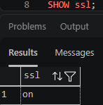
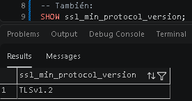
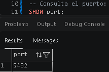
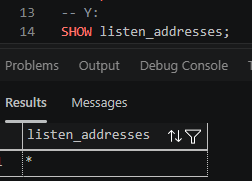
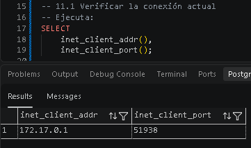
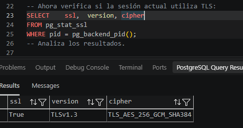
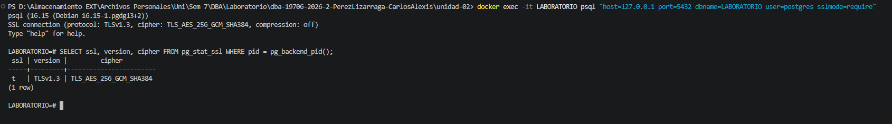

# TLS
## 10. Actividad 4 — Protección de datos durante la comunicación
Hasta este momento hemos protegido información almacenada.
Ahora analizaremos otro problema:
- ¿Qué sucede con la información mientras viaja entre el cliente y PostgreSQL?

Una consulta como:
`SELECT * FROM clientes;`

Viaja entre el cliente y el servidor.
Si la conexión no está protegida, una persona con capacidad para observar el tráfico de red podría intentar obtener información de la comunicación.
Para resolver este problema se utiliza TLS (Transport Layer Security).

## 11. Actividad 5 — Verificar el estado de TLS en PostgreSQL
### Evidencias querys

### 11.1 Verificar la conexión actual

**Preguntas**
1. **¿La conexión actual utiliza TLS?**\
Sí, el campo `ssl` devuelve `true`.
1. **¿Qué versión de TLS se está utilizando?**\
Muestra `TLSv1.2`.
1. **¿Qué algoritmo de cifrado aparece?**\
Muestra el conjunto de cifrado activo en la sesión (`TLS_AES_256_GCM_SHA384`).
1. **¿Qué diferencia existe entre una conexión protegida con TLS y una conexión sin TLS?**\
TLS cifra el tráfico de red garantizando confidencialidad e integridad, mientras que sin TLS la información viaja en texto claro y puede ser capturada o modificada por terceros en la red.
### Evidencias querys

## 12. Actividad 6 — Conexión mediante psql

En mi caso al realizar la practica en Visual Studio Code usando la extensión de PostgreSQL para conectarme a un contenedor de docker con imagen de Postgres:16 opte por llevar a cabo este ejemplo de la manera que se muestra en la imagen de evidencia.

### Evidencias querys

