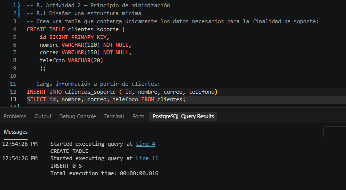
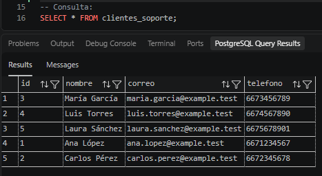
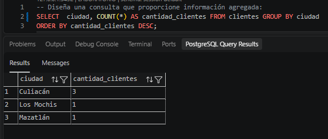
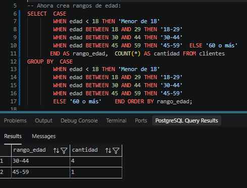
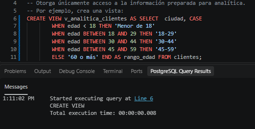
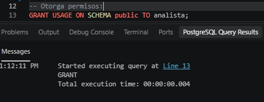
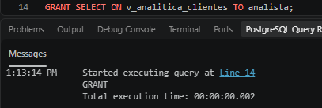
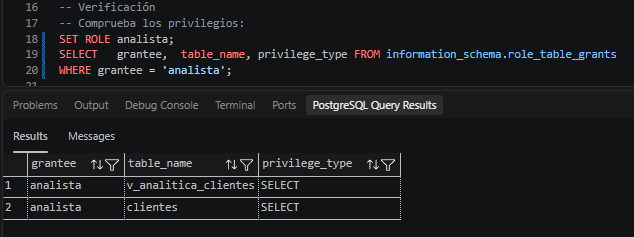

# Inventario de datos
## 7. Actividad 1 — Inventario y finalidad de los datos

|Campo|¿Es dato personal?|Finalidad|¿Es necesario?|Nivel de acceso|Retención|
|:---:|:---:|:---:|:---:|:---:|:---:|
|id|No|Identificador unico de la base de datos|Sí|DBA, Operación|Mientras el usuario este activo|
|nombre|Sí|Identificador formal para atención y facturación|Sí|Atención al cliente, Facturación|Durante la relación contractual|
|correo|Sí|Medio de contacto principal y envio de notificaciones de soporte|Sí|Atención al cliente|Durante la relación contractual|
|telefono|Sí|Contacto telefónico para soporte directo o validaciones|Sí|Atención al cliente|Durante la relación contractual|
|rfc|Sí|Emisión de comprobantes fiscales de pago|Sí|Facturación|Obligación legal|
|edad|Sí|Segmentación demográfica|Sí para analisis|Analisis|Indefinido|
|ciudad|Sí|Análisis de geografico de la base de clientes|Sí|Analítica, Operación|Mientras dure el análisis|
|codigo_postal|Sí|Logística de envíos y segmentación por región|Sí para logistica|Analisis, Operación|Mientras dure la relación comercial|
|fecha_alta|No|Control del ciclo de vida y antigüedad de la cuenta|Sí|DBA, Operación|Indefinido|

Para cada decisión debes proporcionar una justificación.

- Los datos personales directos (nombre, correo, teléfono) únicamente se requieren para atención al cliente y soporte operativo.
- El rfc solo debe ser accesible por el departamento de facturación para cumplir con requerimientos fiscales.
- La edad, ciudad y codigo_postal no deben ser consultados directamente por usuarios analíticos en formato individual, sino a través de agregaciones que impidan reidentificar al titular. 
## 8. Actividad 2 — Principio de minimización

Supongamos que el área de atención al cliente solicita crear una nueva tabla:

```sql
CREATE TABLE clientes_soporte (
    id BIGSERIAL,
    nombre VARCHAR(120),
    correo VARCHAR(150),
    telefono VARCHAR(20),
    rfc VARCHAR(13),
    edad INTEGER,
    ciudad VARCHAR(80),
    codigo_postal VARCHAR(10),
    fecha_alta DATE
    );
```

Analiza la solicitud.

**Preguntas**
1. **¿Todos los campos son necesarios para atención al cliente?**<br>No. Los campos rfc, edad, ciudad, codigo_postal y fecha_alta no son necesarios para atender solicitudes comunes de soporte técnico o atención telefónica.
2. **¿Por qué soporte necesitaría conocer el RFC?**<br>Soporte no necesita conocer el RFC. El RFC se requiere exclusivamente para el proceso fiscal y de facturación. Exponerlo a soporte incrementa innecesariamente el riesgo de fuga de información fiscal.
3. **¿Necesita conocer la edad?**<br>No. La edad no condiciona la resolución de un ticket de atención al cliente ni la validación de identidad para soporte técnico básico.
4. **¿Necesita conocer el código postal?**<br>No para atención remota o digital. Únicamente se justificaría si la empresa ofreciera soporte físico domiciliario, lo cual no es el caso en la operación básica planteada.
5. **¿Qué principio de privacidad está relacionado con esta decisión?**<br>El Principio de Minimización de Datos (que establece que los datos tratados deben ser únicamente los adecuados, relevantes y estrictamente necesarios para la finalidad del tratamiento).

### Evidencias de querys




## 9. Actividad 3 — Separación por finalidad

**Pregunta**
- **¿Por qué esta información puede ser más apropiada para analítica que entregar
directamente la tabla completa de clientes?**<br>
Porque el área de analítica necesita identificar tendencias y estadísticas globales (como el volumen de clientes por región o grupo etario), no a los individuos particulares. Entregar la tabla completa expone Datos Personales Identificables (PII) innecesariamente. Al proporcionar solo datos agrupados y categorizados por rangos, se disocia la información, reduciendo drásticamente el riesgo de un incidente de privacidad y cumpliendo con el principio de limitación de finalidad.

### Evidencias de querys



## 10. Actividad 4 — Control de acceso relacionado con la finalidad

**Preguntas**
1. **¿Qué información puede consultar el rol?**<br>El rol analista debe consultar únicamente los datos agregados e indirectos expuestos por la vista v_analitica_clientes (es decir, la columna ciudad y la columna calculada rango_edad).
2. **¿Puede consultar directamente clientes?**<br>De acuerdo con el diseño de gobierno y seguridad, no debe tener acceso (En la captura de evidencia muestra que analista tiene privilegios para consultar la tabla, pero esto no es verdad, ya que si se intenta consultar la tabla con el rol de analista el acceso sera denegado).
3. **¿Puede obtener nombre, correo y RFC?**<br>No, porque la vista v_analitica_clientes excluye deliberadamente esos campos de su definición SQL.
4. **¿Qué principio de privacidad estás aplicando?**<br>El principio de Limitación de finalidad (y minimización de datos).
5. **¿Qué principio de seguridad estás aplicando?**<br>El Principio de Mínimo Privilegio (Least Privilege), que dicta que un usuario o rol solo debe poseer los permisos estrictamente necesarios para realizar sus funciones operativas asignadas.

### Evidencias de querys



