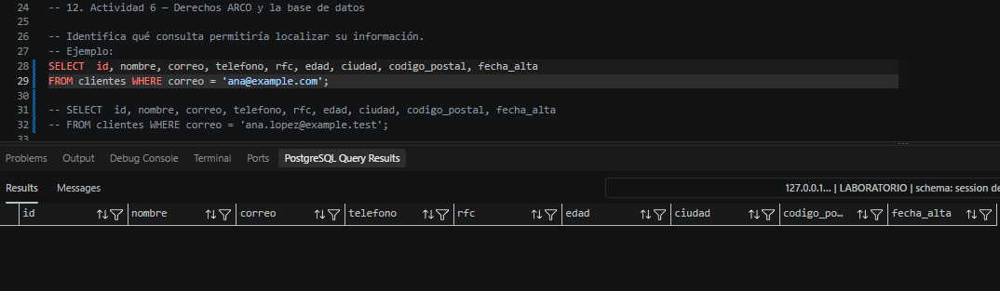
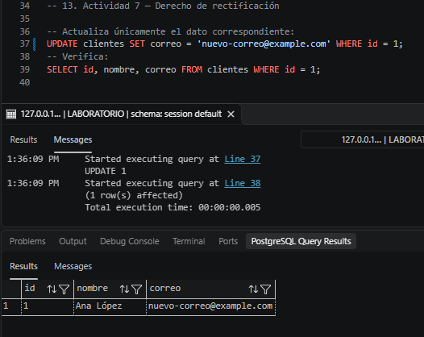

# Finalidad secundaria
## 11. Actividad 5 — Analizar una finalidad secundaria

La empresa propone utilizar los datos de clientes para una nueva finalidad:
“Enviar promociones personalizadas basadas en la edad, ciudad y comportamiento de
compra.”
Analiza la situación.

Responde:
1. **¿El hecho de que la organización ya tenga los datos significa automáticamente que puede utilizarlos para cualquier finalidad?** No. El Principio de Limitación de Finalidad establece que los datos recopilados para un propósito inicial no pueden ser utilizados voluntariamente para fines secundarios sin contar con una base jurídica o el consentimiento previo del titular.
2. **¿Qué preguntas debería realizar la organización antes de implementar este tratamiento?** 
    - ¿La finalidad secundaria fue informada explícitamente en el Aviso de Privacidad aceptado por el cliente?
    - ¿Se requiere consentimiento previo y expreso o basta con una opción de exclusión?
    - ¿Qué datos son los estrictamente mínimos necesarios para enviar la promoción?
    - ¿Existen mecanismos para que el cliente ejercite su derecho de oposición a recibir estas campañas? 
3. **¿Qué datos serían realmente necesarios?** Únicamente el canal de comunicación (correo o teléfono) y un identificador o categoría de segmentación (ejemplo: ciudad o etnia), omitiendo datos sensibles, nombre completo o RFC.
4. **¿Necesitaría el área de marketing acceso directo a clientes?** No. Otorgar acceso directo a la tabla operativa expone toda la información sensible (como RFC o historial completo). Marketing solo debe consultar vistas dedicadas o listas filtradas.
5. **¿Qué controles técnicos podrían limitar la información entregada?** 
    - La reación de una vista que filtre solo correos de clientes que hayan otorgado su consentimiento expreso.
    - Otorgar únicamente privilegios SELECT sobre la vista promocional y revocar accesos a la tabla base clientes.   

## 12. Actividad 6 — Derechos ARCO y la base de datos

### 12.1 Derecho de acceso
Pregunta
- **¿Qué información adicional debería proporcionar la organización además del resultado de
esta consulta?** *No necesitas resolver jurídicamente la solicitud. Identifica las implicaciones técnicas.* 
    1. Las finalidades concretas para las cuales se están tratando sus datos personales.
    2. Las transferencias realizadas o previstas de sus datos a terceros (si existen).
    3. El origen de los datos (si no fueron obtenidos directamente del titular).
    4. El periodo de conservación estimado o los criterios para su determinación.
    5. Los derechos que le asisten para solicitar la rectificación, cancelación u oposición de los mismos.

### Evidencias de querys

## 13. Actividad 7 — Derecho de rectificación

Preguntas
1. **¿Cómo podría comprobarse que el cambio fue autorizado?** Mediante la vinculación de la operación en la base de datos con un folio de solicitud de rectificación gestionado por el área de Privacidad o Atención al Cliente, donde conste la verificación previa de la identidad del titular.
2. **¿Debería registrarse quién realizó el cambio?** Sí. Debe existir un registro de auditoría que almacene la identidad del usuario de la BD que ejecutó el UPDATE, la fecha/hora y los valores original y nuevo.
3. **¿Por qué la trazabilidad será importante?** Garantiza la rendición de cuentas, la integridad de la base de datos y permite demostrar en inspecciones o auditorías legales que la modificación respondió a una solicitud válida del titular y no a un incidente de alteración de datos.

### Evidencias de querys

