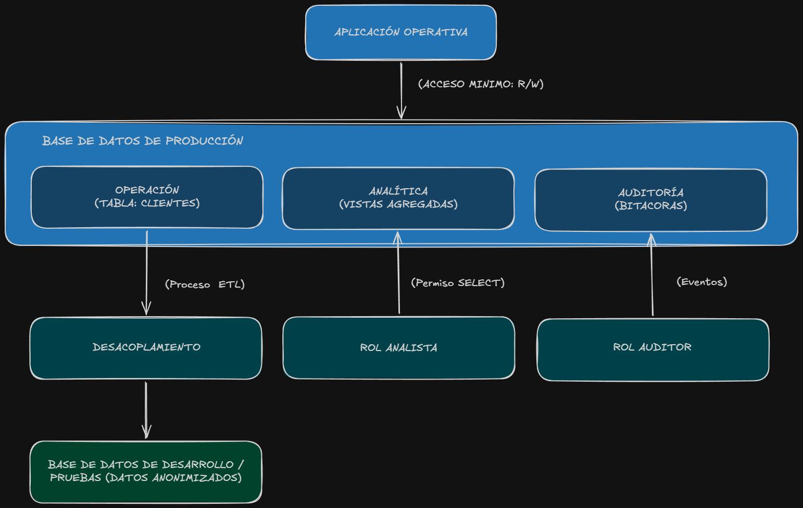

# Arquitectura
## 21. Actividad 15 — Propuesta de arquitectura de datos protegidos

Diseña una propuesta conceptual para separar la información de acuerdo con su finalidad.

1. **Aislamiento por Esquemas y Vistas (Minimización y Finalidad)**
    - El área transaccional accede al esquema de operación.
    - Analítica consulta únicamente el esquema de analítica compuesto por Vistas que agregan datos (``COUNT(*)``, rangos de edad) sin exponer PII.

2. **Control de Acceso basado en Roles (RBAC):**
Roles independientes (rol_operacion, rol_analista, rol_auditor) configurados mediante GRANT estricto bajo el principio de mínimo privilegio.
3. **Ambiente de Desarrollo Seguro:**
Los desarrolladores nunca reciben copias de la BD productiva. Se aplica un proceso ETL de anonimización previo a la carga en entornos no productivos.
4. **Trazabilidad y Auditoría:**
Un esquema reservado de auditoría registra los cambios (``INSERT, UPDATE, DELETE``) sobre datos personales, permitiendo verificar solicitudes ARCO y trazabilidad de operaciones.
5. **Ciclo de Vida y Retención:**
Ejecución de scripts de depuración o archivado periódico para eliminar registros cuyo periodo legal de conservación haya caducado.  